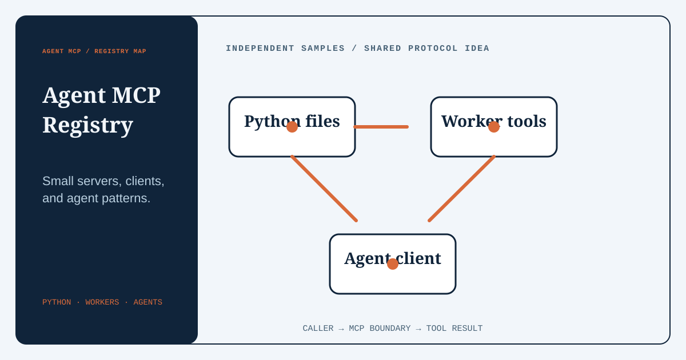
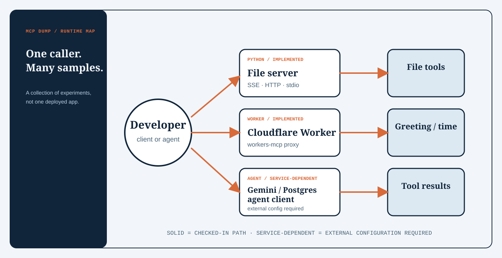

  
  <h1>Agent MCP Registry</h1>
  
<strong>A growing catalog of MCP servers, clients, and integration patterns for agent-tool systems.</strong>

  
Current entries are experimental samples, not a production-ready MCP distribution.

  
  
  
  

  [What is it?](#what-is-it) · [Quick start](#quick-start) · [Current catalog](#current-catalog) · [Architecture](#architecture) · [Limitations](#limitations)

  

## What is it?

Agent MCP Registry is a growing collection of independently documented Model Context Protocol implementations and integration patterns. It is for developers exploring how agent-tool interfaces, servers, and clients fit together. Its most complete current path is a Python FastMCP server that confines file operations to a configured workspace.

The repository also contains a standalone email-validation MCP, a TypeScript Cloudflare Worker, Gemini and LangGraph client examples, and an Azure OpenAI agent that expects an external Postgres MCP server. These samples do not form one deployable application, and their maturity varies.

Entries, runtimes, and integrations may change as the registry grows. Each entry remains independently documented so its current capabilities and limitations are clear.

## Catalog direction

The registry grows through self-contained entries that make one integration idea easy to inspect, adapt, or replace. Future entries can cover local and hosted servers, client patterns, tool safety, evaluation helpers, and deployment approaches.

Only checked-in, documented implementations are presented as available. The catalog below is the source of truth for what the repository currently contains.

## Quick start

The shortest self-contained path starts the Python file server. It requires [Python 3.13 or newer](mcp-files/pyproject.toml) and [\`uv\`](https://docs.astral.sh/uv/).

\`\`\`bash
git clone https://github.com/jayanth-mkv/agent-mcp-registry.git
cd agent-mcp-registry/mcp-files
uv sync
uv run mcp-server --help
uv run mcp-server
\`\`\`

The server listens on \`127.0.0.1:8000\` over SSE and confines tools to \`workspace/\` by default. Override those values when needed:

\`\`\`bash
uv run mcp-server --host 0.0.0.0 --port 9001 --workspace ./data
\`\`\`

The CLI also exposes \`http\` and \`stdio\` transports. There is no authentication layer, so do not expose the server to an untrusted network.

### Email-validation MCP

The independent [\`mcp-email-validator\`](mcp-email-validator/) server checks syntax and DNS mail routes without sending email. Its SMTP recipient probe is disabled by default and should only be enabled for addresses and infrastructure you are authorized to assess.

\`\`\`bash
cd mcp-email-validator
uv sync
uv run mcp-email-validator --transport stdio
\`\`\`

## Current catalog

| Path | Status | What the code implements |
| --- | --- | --- |
| [\`mcp-files/mcp-server\`](mcp-files/mcp-server/) | Implemented, experimental | FastMCP server with 14 file, directory, search, metadata, and workspace-stat tools. |
| [\`mcp-email-validator\`](mcp-email-validator/) | Implemented, experimental | FastMCP server for syntax, DNS mail-route, and bounded opt-in SMTP recipient checks. |
| [\`mcp-files/examples/clients\`](mcp-files/examples/clients/) | Experimental | Plain FastMCP, Gemini, and LangGraph client examples targeting the local SSE server. |
| [\`mcp-hello\`](mcp-hello/) | Implemented, experimental | Cloudflare Worker methods for a greeting and current time, routed through \`workers-mcp\`. |
| [\`mcp-postgres\`](mcp-postgres/) | Experimental, service-dependent | Azure OpenAI ReAct agent that loads tools from a separately hosted Postgres MCP endpoint. |
| [\`mcp-files/mcp-hello\`](mcp-files/mcp-hello/) | Documentation stub | Notes for the Worker example; the TypeScript implementation itself is at the repository root. |

### Python file tools

The local server implements these outcomes:

- Create, read, overwrite, append, copy, move, rename, and delete paths.
- List files and directories, search a text file, and check whether a path exists.
- Return file metadata and aggregate workspace statistics as JSON.
- Reject paths that resolve outside the configured workspace.

\`delete_path\` recursively removes directories inside that workspace. Treat access to the server as write access to the configured directory.

### Optional agent clients

Start the file server first, then set \`GOOGLE_API_KEY\` before running either Google-backed example:

\`\`\`bash
cd mcp-files
uv run examples/clients/gemini.py
# or
uv run examples/clients/react_agent.py
\`\`\`

The Postgres example separately requires Azure OpenAI credentials and \`MCP_RENDER_URL\`; it does not include or start the Postgres MCP server it connects to.

## Architecture

  

Each catalog entry chooses a different entry point and transport, but the implemented direction is the same: a caller reaches an MCP boundary, invokes the tools supplied by that entry, and receives a runtime-specific result.

## Maturity and gaps

This registry is still maturing, not a versioned product. Before building on it, note these checked-in mismatches:

- \`mcp-files/examples/clients/base.py\` calls \`create_file\` with \`filename\`, while the server tool requires \`path\`.
- The Cloudflare Worker tests still assert the starter response \`Hello World!\`; the current worker instead delegates requests through \`ProxyToSelf\`.
- There is no root command that installs, runs, or tests every experiment.
- Some nested documentation describes files that live elsewhere in the repository.

## Limitations

- The file server has no authentication, authorization policy, quotas, or automated tests.
- The email-validation server is not a mailbox-ownership or deliverability guarantee; SMTP probing is opt-in, bounded, and can be affected by catch-all or anti-abuse behavior.
- Text tools assume UTF-8 and are not designed for binary or very large files.
- The Gemini, LangGraph, Azure OpenAI, Postgres MCP, and Cloudflare paths require external credentials or services.
- The Postgres example has no local dependency manifest, so its environment is not reproducible from that folder alone.
- \`mcp-files/\` and \`mcp-email-validator/\` include their own license files; the repository root does not currently state reuse terms for the full collection.

## Development

The TypeScript sample declares its checks in [\`mcp-hello/package.json\`](mcp-hello/package.json):

\`\`\`bash
cd mcp-hello
npm ci
npm test -- --run
\`\`\`

Update the stale Worker assertions before treating that test command as a passing verification gate. New Python tools belong in [\`tools.py\`](mcp-files/mcp-server/src/mcp_server/tools.py) and should include focused tests for path confinement and destructive operations.
